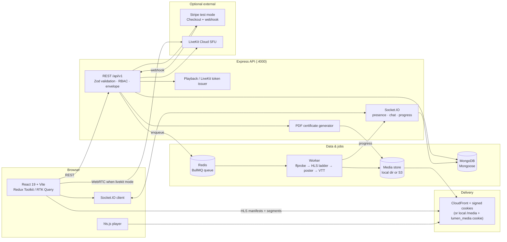
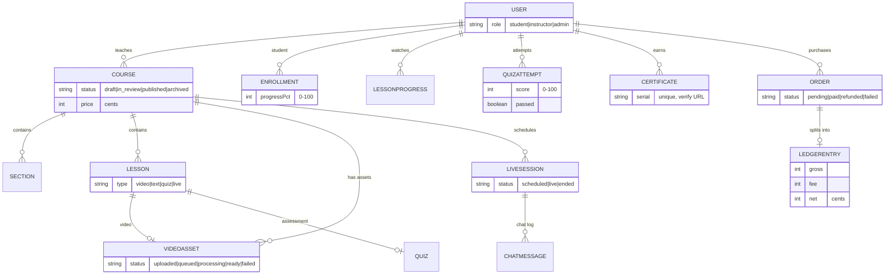
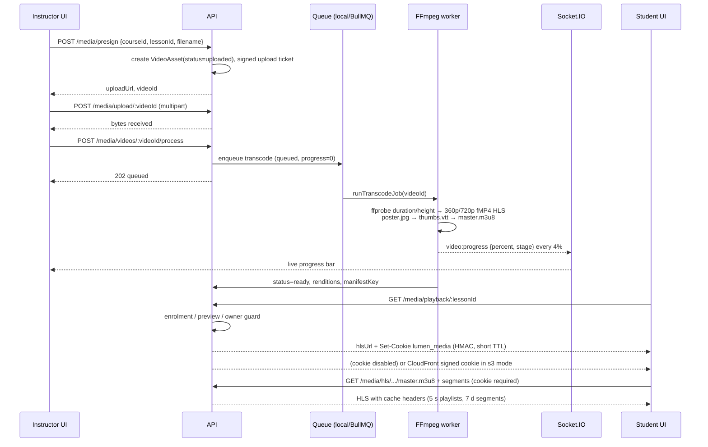
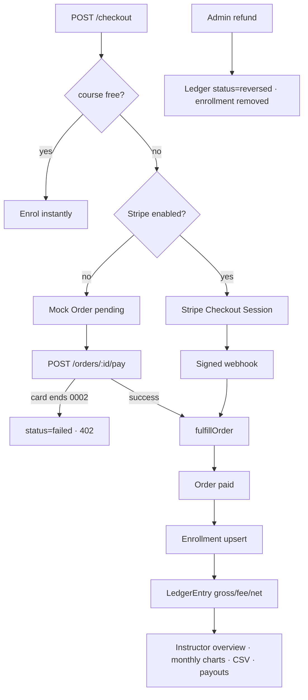

# Lumen Academy — Architecture

## 1. System overview

The platform is a modular monolith with one Express API process, one React SPA, and an FFmpeg worker that can run in-process or as a separate BullMQ consumer. External infrastructure is abstracted behind six driver switches, so the exact same code runs as a laptop demo or a cloud deployment.



### Driver boundaries

| Concern | Interface / entry point | Local default | Production path |
|---|---|---|---|
| Database | `config/db.ts: connectDb()` | bundled `mongodb-memory-server` on `:27099`, persisted to `.data/mongo` | `MONGODB_URI` → Atlas replica set |
| Queue | `services/queue.ts: enqueueTranscode()` | serial in-process promise chain | `QUEUE_DRIVER=bullmq` → Redis + `apps/api/src/worker.ts` |
| Media | `lib/media.ts` (`createUploadTicket`, `publishVideoAssets`, `authorizePlayback`) | `media/` tree + `lumen_media` HMAC cookie | `MEDIA_DRIVER=s3` → private bucket + CloudFront signed cookies |
| Payments | `services/payments.ts: fulfillOrder/refundOrder` | mock card fields | `PAYMENTS_DRIVER=stripe` → Checkout + verified webhook |
| Live | `services/livekit.ts: createLiveToken()` | `simulated` — local camera preview + Socket.IO chat | `LIVE_DRIVER=livekit` → LiveKit room token with role grants |
| Encoding | `services/videoProcess.ts: processVideo()` | `ffmpeg-static` binary from npm | same binary; scale by worker concurrency |

The critical design rule: **business logic lives in services, never in drivers.** `fulfillOrder`, `processVideo`, and `authorizePlayback` are identical regardless of which backend is selected. That is why switching drivers needs no client change.

---

## 2. Workspaces and module boundaries

```
packages/shared   → zod schemas, DTOs, domain constants (imported by API and web)
apps/api          → Express app, Mongoose models, services, Socket.IO, seed script
apps/web          → React SPA, RTK Query API slice, Redux auth slice, pages
```

`packages/shared` is the single source of truth for role names, course statuses, question types, price/threshold constants, and request schemas. Both server and client validate against the same Zod definitions, which removes an entire class of "client allows, server rejects" mismatches.

### Server layers

| Layer | Responsibility | Example |
|---|---|---|
| Routes | HTTP shape, auth + role guards, validation, DTO serialization | `routes/courses.ts` |
| Middleware | `requireAuth`, `requireRole`, `optionalAuth`, `requireMediaAccess`, Zod validation | `middleware/auth.ts` |
| Services | Business rules and transactions across models | `services/payments.ts`, `services/progress.ts` |
| Models | Mongoose schemas, indexes, invariants | `models/commerce.ts` |
| Lib | Cross-cutting helpers: JWT, media keys, errors, serialization, Stripe client | `lib/` |
| Realtime | Socket.IO auth, rooms, chat persistence, progress fan-out | `realtime/socket.ts` |

Every response uses the envelope `{ ok: true, data }` or `{ ok: false, error: { code, message, details? } }`. The web `baseQuery` unwraps it, so components work with plain DTOs and a single `errorMessage()` helper.

---

## 3. Data model



| Collection | Key fields | Notable indexes / rules |
|---|---|---|
| `users` | name, email, passwordHash (bcrypt), role, status, headline, bio | unique email; suspended users rejected at login and socket handshake |
| `courses` | title, slug, category, level, price, instructor, status, sections[], stats{}, cover{} | unique slug; `{status, category, price}`; `mine=1` filters by instructor |
| `lessons` | course, sectionId, order, type, body, video, quiz, durationSec, isPreview | ordered by `order`; previews visible to guests |
| `videoassets` | course, lesson, originalKey, status, progress, renditions[], manifestKey, posterKey | status lifecycle; files keyed by asset id |
| `enrollments` | student, course, pricePaid, progressPct, completedAt, certificateId | **unique** `(student, course)`; repeat enroll is idempotent |
| `lessonprogress` | student, course, lesson, watchedSeconds, completed | unique per `(student, lesson)`; drives progress rollup |
| `quizzes` / `quizattempts` | questions[] with correct answers stored server-side; score 0–100, passed | answers stripped from student-facing DTO; attempt limit enforced server-side |
| `livesessions` / `chatmessages` | roomName, scheduledAt, status; chat persisted by session | chat `(session, createdAt)` index; 6 messages / 10 s rate limit |
| `certificates` | serial, student, course, issuedAt, pdfKey, verifyHash | unique serial; idempotent issue per `(student, course)` |
| `orders` / `ledgerentries` | amount in cents, provider, providerSessionId, status; gross/fee/net, status | partial unique index on string `providerSessionId`; `net = gross − 20%` |

**Why a partial index on `providerSessionId`:** mock orders have no provider session and store `null`. A sparse unique index still indexes explicit `null`, so the second mock order collided. The index uses `partialFilterExpression: { providerSessionId: { $type: 'string' } }`, which enforces uniqueness only for real Stripe session IDs.

---

## 4. Key request lifecycles

### 4.1 Video upload → transcode → playback



Transcode details (`services/videoProcess.ts`):

- `ffprobe` derives duration and source height; the ladder is filtered to heights ≤ source (minimum 360p).
- Each rendition uses `libx264 -profile:v main -preset veryfast -crf 23`, AAC audio, **fMP4** segments (`hls_segment_type fmp4`, `hls_time 4`, `independent_segments`).
- A `master.m3u8` with `EXT-X-STREAM-INF` is written for ABR switching.
- A poster frame and a 10-thumbnail WebVTT track are produced for the scrub preview.
- Progress is parsed from ffmpeg's `out_time_ms` and reported coarsely (every 4%) to avoid socket spam.
- Failures set `status=failed` with a truncated error string and emit `video:failed`.

### 4.2 Quiz grading and progress

1. `GET /quizzes/:id` strips `correct` and `explanation` from every question and returns the learner's prior attempts, best score, and attempt count.
2. `POST /quizzes/:id/attempts` verifies enrollment, enforces `attemptsAllowed`, and stores `startedAt` (+ `expiresAt` when timed).
3. `PATCH /attempts/:id/submit` re-reads the answer key server-side, verifies ownership, rejects double submission and expired timers (+15 s grace), and grades with per-question partial credit for multi-select.
4. A passing score linked to a lesson marks that lesson complete and recomputes course progress.
5. `recomputeCourseProgress` counts completed lessons, writes `progressPct`, and auto-issues the certificate at 100%.

A video lesson counts as watched once ≥90% of its duration has been observed (`COMPLETION_THRESHOLD = 0.9`), or when the player explicitly reports completion.

### 4.3 Certificate generation

`services/certificates.ts` uses `pdfkit` to draw an A4 certificate: Fraunces wordmark, ember wax seal, student/course/instructor names, issue date, unique serial and a QR code pointing at `${CLIENT_ORIGIN}/verify/${serial}`. Issuance is idempotent via `Certificate.findOne({student, course})`, so replaying completion never duplicates a PDF. Download requires a bearer token; verification by serial is public.

### 4.4 Payments and revenue



`fulfillOrder` is the single idempotent write path used by both drivers: if the order is already `paid` it returns early; the ledger entry and enrollment are created only once. `net = gross − round(gross × platformFeePct / 100)`. Refunds reverse the ledger row and remove the enrollment and progress.

### 4.5 Live classes

Instructor scheduling creates a `LiveSession` with a deterministic `roomName` and (in LiveKit mode) provisions the room. `POST /live/:id/token` checks enrollment/host status and returns either a short-lived LiveKit JWT with publisher grants or `mode: 'simulated'`. The web client lazy-loads `LiveKitStage` only when a real token exists; otherwise it shows a local `getUserMedia` preview. Socket.IO rooms carry presence, status changes and chat; chat is persisted to MongoDB and survives reload. Host-only `PATCH /live/:id/status` writes a system chat message and broadcasts `live:status`.

---

## 5. Security and access control

- **Auth:** 15-minute access JWT in memory + 7-day httpOnly refresh cookie. On load the SPA calls `POST /auth/refresh`; on a 401 RTK Query retries once after refreshing.
- **RBAC:** `requireRole('instructor','admin')` on authoring routes; admin-only metrics/users/orders; students cannot read another learner's attempts, certificates or orders.
- **Course ownership:** every mutation resolves the course and checks `course.instructor === auth.userId || role === 'admin'`.
- **Media gating:** `GET /media/playback/:lessonId` authorizes first, then issues an HMAC `lumen_media` cookie required by `express.static('/media')`. `MEDIA_OPEN=true` disables the gate for debugging only.
- **Quiz integrity:** correct answers and explanations never leave the server in the student DTO; grading recomputes from Mongo.
- **Webhook integrity:** raw body is captured before `express.json()`, and `checkout.session.completed` is verified with `constructEvent` using the signing secret.
- **Hardening:** helmet, CORS allowlist with credentials, rate limit on auth routes (40/min), regex escaping on all user-supplied search terms, Zod validation on all inputs.
- **Socket handshake:** access token verified and user status rechecked on connect; room membership rechecked against enrollment on `live:join` and `chat:send`.

---

## 6. Rendering and delivery

- Vite build emits hashed, code-split bundles. `LiveKitStage` (~650 kB raw / 176 kB gzip) and `hls.js` (~579 kB raw / 181 kB gzip) load only on the routes that need them.
- When `apps/web/dist` exists the API serves the SPA and falls back to `index.html` for client-side routes — one process can serve the whole app.
- Playlists get `Cache-Control: public, max-age=5`; segments and posters get `max-age=7d` with permissive cross-origin resource policy for HLS range requests.
- The catalog is paginated (12 default, max 48) and supports `q`, `category`, `level`, `price`, `sort`, `page`, `pageSize`, plus `mine`/`status` for instructor views.

---

## 7. Deployment notes

For a cloud deployment:

1. Set `MONGODB_URI` to an Atlas replica set.
2. Upload media to a private S3 bucket; configure CloudFront OAC and a trusted key group, then set `MEDIA_DRIVER=s3` and the CloudFront key pair variables. Signed cookies are issued by `authorizePlayback`.
3. Set `QUEUE_DRIVER=bullmq` + `REDIS_URL`, run `npm run worker` as a separate process, and scale workers horizontally (concurrency 1 each).
4. Set real `JWT_ACCESS_SECRET` / `JWT_REFRESH_SECRET`.
5. For payments set `PAYMENTS_DRIVER=stripe`, `STRIPE_SECRET_KEY`, `STRIPE_WEBHOOK_SECRET`, and point the webhook at `/api/v1/webhooks/stripe`.
6. For live video set `LIVE_DRIVER=livekit` and the LiveKit Cloud credentials.
7. Build the web app (`npm run build`) and start the API (`npm start`) — it serves the built SPA and media in one process, or put a CDN in front.

All seven switches are independent; the mock/simulated defaults can be replaced one at a time without touching application code.
